# ByteHound 0.3.0 — Manual de uso

**Analisador de espaço em disco multiplataformas · Software gratuito (freeware)**

O ByteHound mostra o que está ocupando o seu disco, ajuda a localizar arquivos e permite agir sobre eles com confirmação. Ele também organiza fotos por local, data e aparelho, identifica arquivos descartáveis e gera relatórios em HTML.

## Vesões inicias

Windows , linux e versão mac em breve

> As telas deste manual foram feitas no Windows, com uma pasta de demonstração de arquivos fictícios.

## Sumário

1. [Requisitos e instalação](#1-requisitos-e-instalação)
2. [Primeira verificação](#2-primeira-verificação)
3. [Árvore, extensões e mapa](#3-árvore-extensões-e-mapa)
4. [Filtros](#4-filtros)
5. [Busca](#5-busca)
6. [Maiores arquivos](#6-maiores-arquivos)
7. [Prévia de arquivos](#7-prévia-de-arquivos)
8. [Ações sobre arquivos e pastas](#8-ações-sobre-arquivos-e-pastas)
9. [Discos virtuais (Docker, WSL, Hyper-V)](#9-discos-virtuais-docker-wsl-hyper-v)
10. [Fotos: locais, grupos, mapa e rede](#10-fotos-locais-grupos-mapa-e-rede)
11. [Limpeza](#11-limpeza)
12. [Relatório HTML](#12-relatório-html)
13. [Tema escuro](#13-tema-escuro)
14. [Linha de comando](#14-linha-de-comando)
15. [Uso com assistentes (MCP)](#15-uso-com-assistentes-mcp)
16. [Privacidade](#16-privacidade)
17. [Limitações e solução de problemas](#17-limitações-e-solução-de-problemas)
18. [Distribuição, garantia e créditos](#18-distribuição-garantia-e-créditos)

---

## 1. Requisitos e instalação

**Requisitos**

- Windows de 64 bits (x64). Esta versão foi testada no Windows 10.
- Suporte a OpenGL pela placa de vídeo e seu driver.
- Somente para compactar discos virtuais: módulo Hyper-V do PowerShell e permissão de administrador.

**Instalação**

Não há instalador.

1. Extraia `ByteHound-0.3.0-win-x64.zip` para uma pasta de sua preferência.
2. Execute `ByteHound.exe`.

O executável não tem assinatura digital, por isso o Windows pode exibir um aviso de segurança na primeira execução. Baixe o programa apenas da fonte oficial de distribuição.

**Conferir a integridade (opcional)**

O arquivo `ByteHound-0.3.0-win-x64.exe.sha256`, distribuído junto, contém o código de verificação do executável **avulso**, `ByteHound-0.3.0-win-x64.exe` (o mesmo programa que está no zip). No PowerShell:

```powershell
Get-FileHash .\ByteHound-0.3.0-win-x64.exe -Algorithm SHA256
```

O valor exibido deve ser igual ao do arquivo `.sha256`.

**Para desinstalar:** apague a pasta do programa. As regras e o histórico da Limpeza, se usados, ficam em `%APPDATA%\ByteHound`.

## 2. Primeira verificação

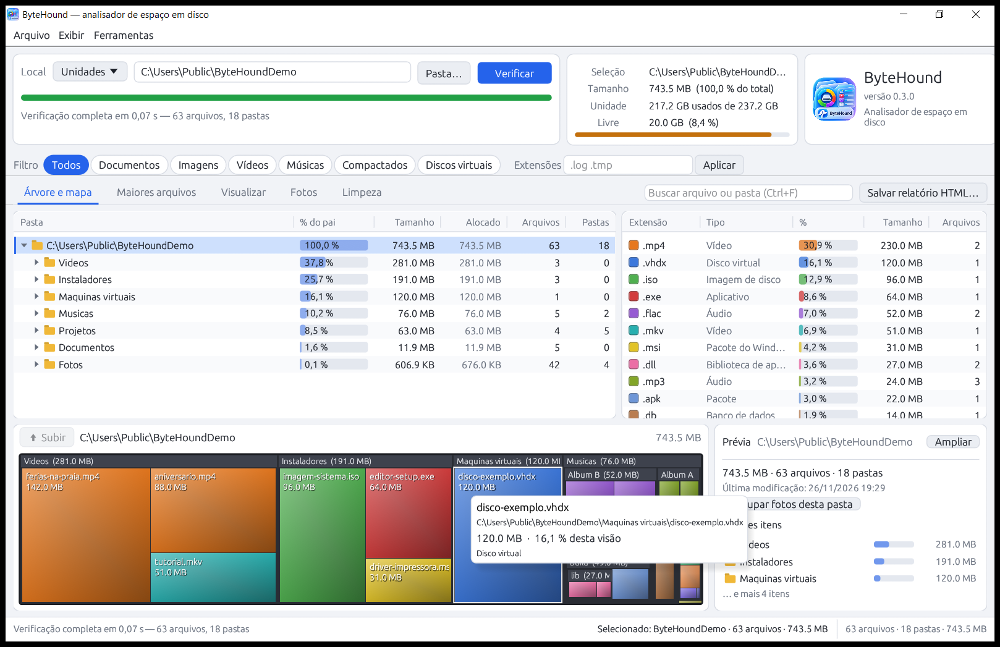

1. Escolha uma unidade em **Unidades**, digite um caminho no campo **Local** ou clique em **Pasta…**.
2. Clique em **Verificar**. O botão **Parar** interrompe a verificação.
3. Ao terminar, aparecem o tempo gasto e o total de arquivos e pastas.

Partes da tela:

| Área | O que mostra |
|---|---|
| Cartão do local | Caminho, progresso e resumo da verificação |
| Cartão da seleção | Item selecionado, tamanho e espaço usado e livre da unidade. A barra fica laranja quando o disco passa de 90 % de uso |
| Abas | Árvore e mapa, Maiores arquivos, Visualizar, Fotos e Limpeza |
| Barra de status | Mensagens, item selecionado e totais |

A verificação não segue links simbólicos. Pastas sem permissão de leitura são contadas como “sem acesso”.

## 3. Árvore, extensões e mapa

**Árvore de pastas.** Mostra percentual em relação à pasta acima, tamanho, espaço alocado, quantidade de arquivos e pastas e a data de modificação (a coluna de data é ocultada em telas estreitas). Clique na seta para abrir uma pasta.

**Extensões.** Mostra cada tipo de arquivo com sua cor, descrição, percentual e tamanho. Um clique destaca a extensão no mapa; um clique duplo filtra por ela.

**Mapa.** Cada bloco é um arquivo, e a área é proporcional ao tamanho. A cor indica a extensão.

- **Passar o mouse:** mostra nome, caminho e tamanho.
- **Clique:** seleciona o item e o mostra na árvore.
- **Clique duplo:** amplia uma pasta ou abre um arquivo.
- **Subir:** volta à pasta acima.
- **Botão direito:** abre o menu de ações.

> O espaço “Alocado” é uma estimativa arredondada para blocos de 4.096 bytes. Hard links são contados mais de uma vez.

## 4. Filtros

A barra **Filtro** limita a visão a **Documentos, Imagens, Vídeos, Músicas, Compactados** ou **Discos virtuais**. Para um filtro próprio, digite extensões em **Extensões** (por exemplo, `.log .tmp`) e clique em **Aplicar**. **Todos** remove o filtro.

## 5. Busca

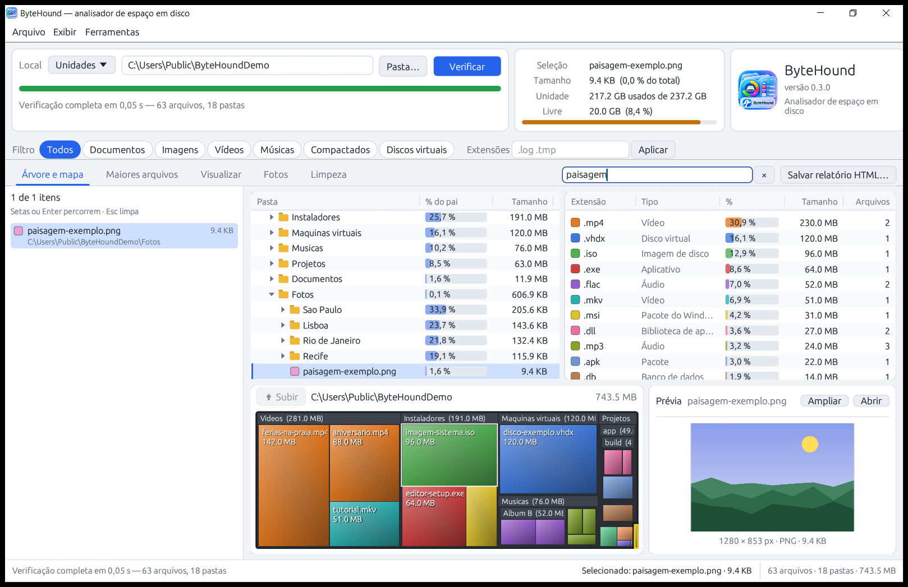

1. Clique no campo de busca ou pressione **Ctrl+F**.
2. Digite. A lista é atualizada após uma breve pausa.
3. O maior resultado é selecionado e localizado na árvore e no mapa.

| Tecla ou ação | Efeito |
|---|---|
| Setas para cima e para baixo | Percorrem os resultados |
| **Enter** / **Shift+Enter** | Próximo / anterior |
| Clique em um resultado | Localiza o item |
| **Esc** ou **×** | Limpa a busca |

A busca não diferencia maiúsculas nem acentos. Com várias palavras, todas precisam aparecer no nome. Um termo com `\` ou `/` é procurado no caminho completo. A lista mostra os 500 maiores resultados e informa o total.

## 6. Maiores arquivos

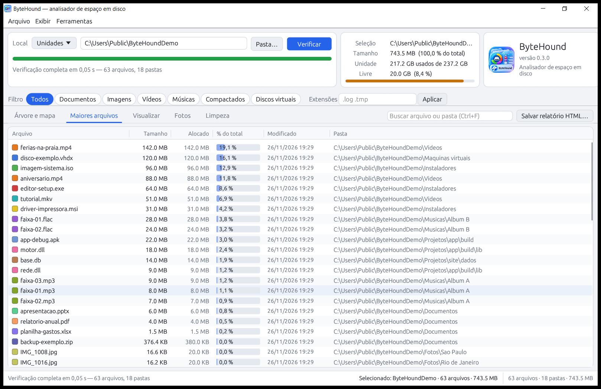

Lista os 1.000 maiores arquivos, com tamanho, espaço alocado, percentual do total, data e pasta. É um bom ponto de partida para liberar espaço.

## 7. Prévia de arquivos

Ao selecionar um item, o painel **Prévia** (ao lado do mapa) mostra o conteúdo sem abrir outro programa, como a imagem na tela da seção [Busca](#5-busca). **Ampliar** leva à aba **Visualizar**.

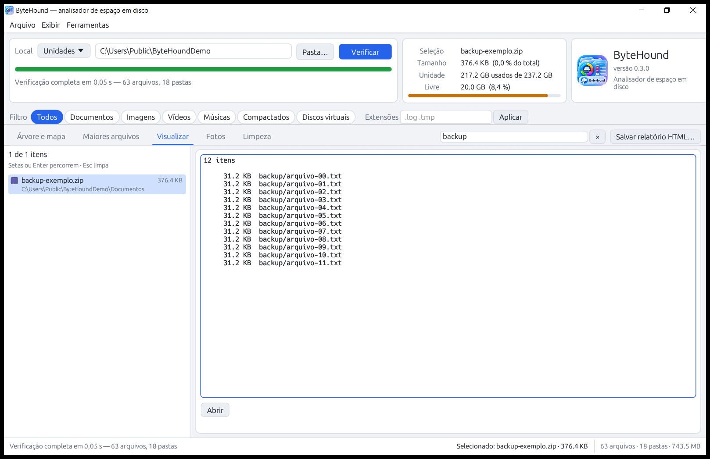

| Tipo | O que é mostrado |
|---|---|
| Imagens PNG, JPEG, GIF, BMP, ICO e WebP | A imagem, as dimensões e, em fotos, os dados do EXIF |
| Texto e arquivos binários | O início do conteúdo (texto ou hexadecimal) |
| ZIP | Lista dos arquivos contidos |
| TAR com Zstandard (`.zst`, `.zstd`, `.tar.zst`, `.tzst`) | Lista ou texto; alguns casos pedem uma expansão temporária |
| Discos VHD e VHDX | Partições e sistema de arquivos; em partições ext2/3/4, lista e extrai arquivos sem montar o disco |
| Pastas | Resumo e maiores itens |

## 8. Ações sobre arquivos e pastas

Clique com o **botão direito** em um item da árvore, do mapa ou das listas.

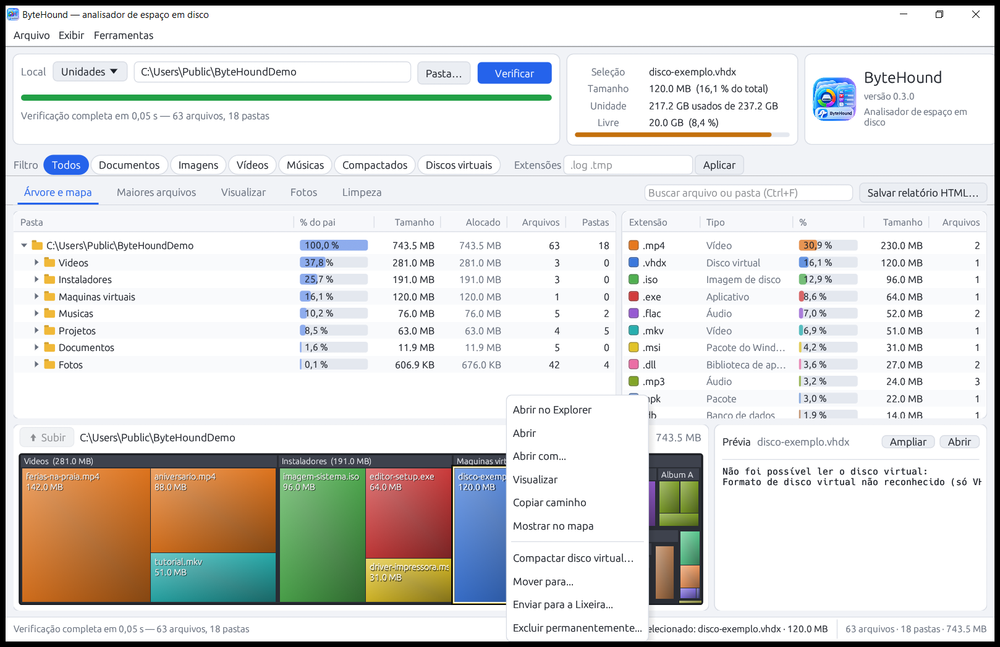

| Opção | O que faz |
|---|---|
| Abrir no Explorer | Mostra o item no Explorador de Arquivos |
| Abrir / Abrir com... | Abre com o programa padrão ou escolhido |
| Visualizar | Abre na aba Visualizar |
| Copiar caminho | Copia o caminho completo |
| Mostrar no mapa | Localiza o item no mapa |
| Agrupar fotos desta pasta | Em pastas: analisa as fotos na aba Fotos |
| Marcar no mapa de fotos | Em fotos: localiza pela coordenada GPS |
| Compactar disco virtual… | Em arquivos `.vhd` e `.vhdx` ([seção 9](#9-discos-virtuais-docker-wsl-hyper-v)) |
| Mover para... | Move para outra pasta |
| Enviar para a Lixeira... | Exclui de forma recuperável |
| Excluir permanentemente... | Exclui **sem possibilidade de recuperação pela Lixeira** |

Antes de abrir tipos que podem executar programas ou montar discos (como `.exe`, `.msi`, `.bat`, `.ps1`, `.iso` e `.vhdx`), o ByteHound pede confirmação.

### Excluir


Toda exclusão pede confirmação, com o caminho completo. Prefira a Lixeira. O espaço só é liberado depois que a Lixeira é esvaziada.

Após excluir ou mover, a árvore, os totais e o mapa são atualizados sem nova verificação. Se o destino estiver fora da pasta verificada, ou for uma pasta criada depois da verificação, o item apenas sai da árvore.

### Mover

**Mover para...** pede a pasta de destino e uma confirmação. Nada é sobrescrito, e não é possível mover uma pasta para dentro dela mesma. Entre unidades diferentes, o item é copiado, o tamanho é conferido e só então a origem é removida.

## 9. Discos virtuais (Docker, WSL, Hyper-V)

Discos virtuais crescem com o uso e não encolhem sozinhos. A opção **Compactar disco virtual…** (botão direito, ou menu **Ferramentas**) usa o `Optimize-VHD` para devolver ao Windows o espaço já liberado dentro do disco.

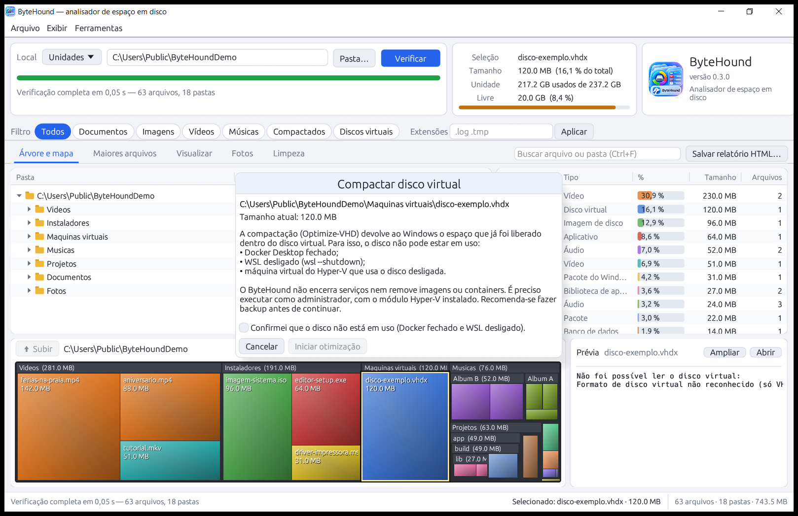

Antes de continuar:

1. Libere o espaço **dentro** do disco, se necessário. A compactação não apaga imagens nem containers.
2. Feche o Docker Desktop.
3. Desligue o WSL com `wsl --shutdown` e desligue máquinas virtuais que usem o disco.
4. Faça uma cópia de segurança.
5. Execute o ByteHound como administrador, com o módulo Hyper-V instalado.
6. Marque a confirmação e clique em **Iniciar otimização**.

> **Atenção:** a compactação ainda não foi validada em um ambiente com Hyper-V. Use somente com cópia de segurança.

## 10. Fotos: locais, grupos, mapa e rede

Selecione uma pasta e clique em **Analisar seleção** na aba **Fotos**, ou use **Agrupar fotos desta pasta** no botão direito. O programa lê os dados EXIF (coordenadas GPS, aparelho e data) e calcula uma assinatura visual de cada imagem. As fotos não são alteradas.

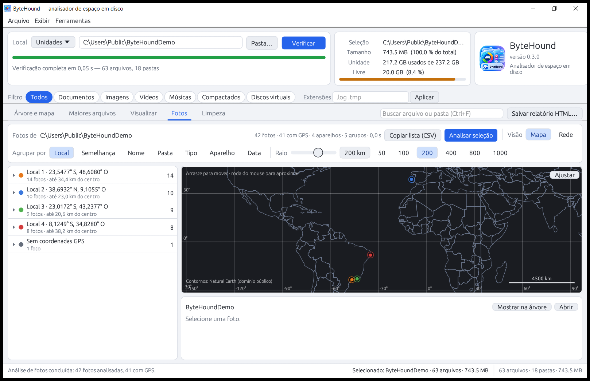

**Agrupar por**

| Modo | Critério |
|---|---|
| Local | Fotos dentro de um raio do centro do grupo. Barra de ajuste e atalhos de 50 a 1.000 km; padrão de 200 km |
| Semelhança | Imagens parecidas; a **Tolerância** define o quanto |
| Nome | Mesmo padrão de nome |
| Pasta | Pasta onde estão |
| Tipo | Formato do arquivo |
| Aparelho | Câmera ou celular |
| Data | Mês em que foram tiradas |

### Localizar uma foto no mapa

Clique em um grupo e depois em uma foto. Ela é marcada em amarelo no mapa, e a prévia mostra aparelho, data e coordenadas. **Marcar no mapa** centraliza a foto.

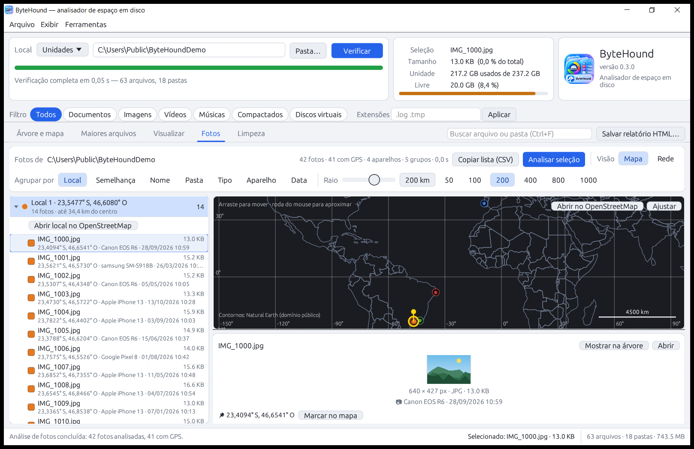

Arraste para mover o mapa e use a roda do mouse para aproximar. **Ajustar** mostra todas as fotos. **Abrir no OpenStreetMap** abre o local no navegador.

### Rede

Cada grupo é um ponto central ligado às suas fotos. Fotos visualmente parecidas também são ligadas entre si.

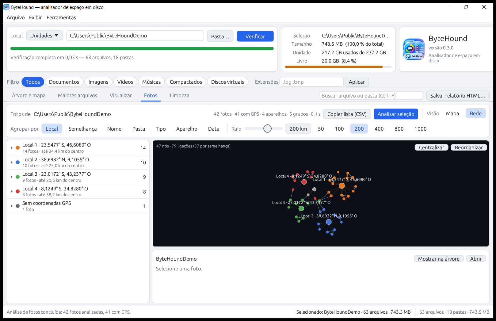

**Copiar lista (CSV)** copia nome, pasta, coordenadas, aparelho, data e grupo.

> Fotos sem GPS ficam no grupo “Sem coordenadas GPS”. Em HEIC, o EXIF é lido, mas não há comparação por semelhança. A rede mostra até 1.500 fotos.

## 11. Limpeza

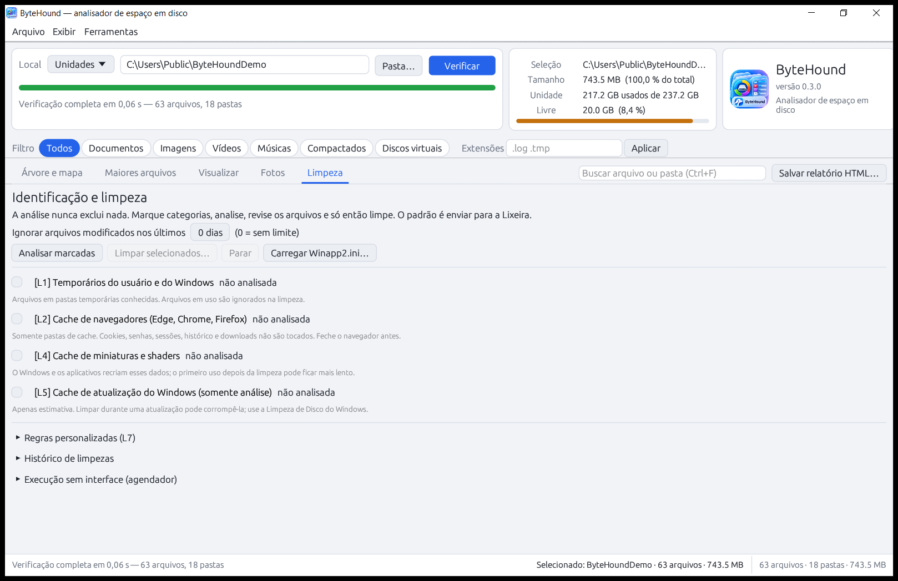

A **análise nunca exclui nada**.

1. Marque as categorias.
2. Se quiser, ignore arquivos modificados nos últimos dias.
3. Clique em **Analisar marcadas**.
4. Em **Ver itens**, revise a lista e desmarque o que quiser manter.
5. Clique em **Limpar selecionados…** e confirme.

| Categoria | Conteúdo |
|---|---|
| L1 | Temporários do usuário e do Windows |
| L2 | Cache do Edge, Chrome e Firefox. Cookies, senhas, histórico e downloads não são tocados. Feche o navegador antes |
| L4 | Cache de miniaturas e shaders, que será recriado |
| L5 | Cache de atualização do Windows (**somente análise**) |
| Winapp2 | Regras carregadas de um arquivo `Winapp2.ini` |
| L7 | Pastas personalizadas, com exclusões |

Por padrão, os itens vão para a **Lixeira**. A exclusão permanente exige uma segunda confirmação. O histórico fica em `%APPDATA%\ByteHound\limpeza.log`, sem nomes de arquivos nem conteúdo.

> Esta aba não atualiza a árvore: faça uma nova verificação para ver o resultado nela. A limpeza no Windows, o envio à Lixeira por esta aba e regras reais de `Winapp2.ini` ainda precisam de testes mais amplos.

## 12. Relatório HTML

Clique em **Salvar relatório HTML…** (na barra de abas ou no menu **Arquivo**).

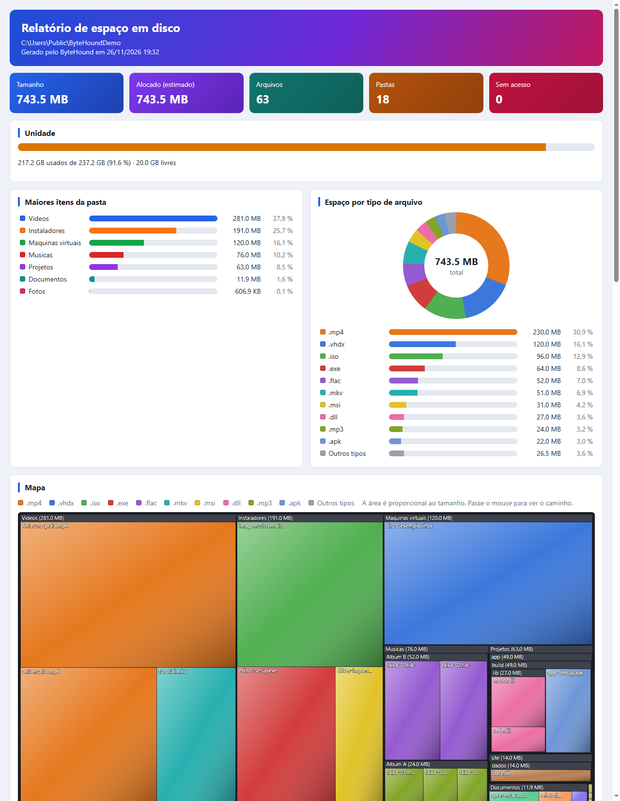

O relatório é um único arquivo, que abre no navegador e funciona sem internet. Traz resumo, uso da unidade, gráficos, mapa, árvore de pastas, extensões e maiores arquivos. Pela janela, ele respeita o filtro ativo.

A árvore do relatório tem até 8 níveis e 60 itens por pasta, e pastas muito pequenas não são abertas.

> **Atenção:** o relatório contém nomes e caminhos de arquivos do computador. Revise antes de compartilhar ou publicar.

## 13. Tema escuro

Ative em **Exibir → Tema escuro**.

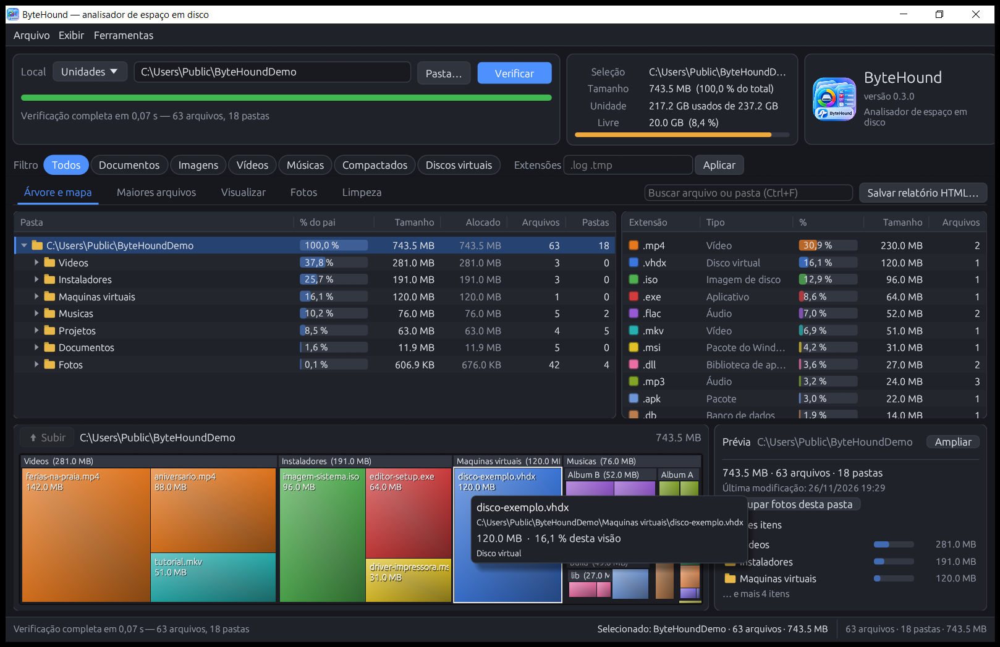

Para iniciar já no tema escuro, defina a variável de ambiente `BYTEHOUND_TEMA=escuro`.

## 14. Linha de comando

| Comando | O que faz |
|---|---|
| `ByteHound.exe` | Abre a janela |
| `ByteHound.exe <pasta>` | Abre e analisa a pasta |
| `ByteHound.exe --relatorio [pasta] [saida.html]` | Mostra o resumo e grava o relatório HTML |
| `ByteHound.exe --busca <pasta> <texto>` | Lista até os 100 maiores resultados (`--search` é igual) |
| `ByteHound.exe --limpeza` | Prévia da limpeza; não apaga nada |
| `ByteHound.exe --mcp` | Servidor MCP |
| `ByteHound.exe --ajuda` | Ajuda (`--help`, `-h`, `/?`) |

Sem pasta, `--relatorio` usa a pasta atual, exceto se ela for a raiz de uma unidade, a pasta do usuário ou a do Windows. Sem `saida.html`, o arquivo é criado na pasta atual. Arquivos existentes não são sobrescritos. Códigos de saída: `0` sucesso, `1` falha, `2` uso incorreto.

**Prompt de Comando (CMD)**

```bat
start /wait "" ByteHound.exe --relatorio "C:\Dados" relatorio.html
```

**PowerShell**

```powershell
Start-Process .\ByteHound.exe -ArgumentList '--busca "C:\Dados" contrato' -NoNewWindow -Wait
```

**Limpeza automatizada**

A opção `--executar` apaga arquivos sem janela de confirmação e exige categorias explícitas. Rode a prévia antes. Por padrão, os itens vão para a Lixeira.

```powershell
Start-Process .\ByteHound.exe -ArgumentList '--limpeza --executar --categorias L1,L2 --dias 7' -NoNewWindow -Wait
```

Opções: `--dias N`, `--winapp2 arquivo.ini` e `--permanente` (apaga **sem** passar pela Lixeira).

## 15. Uso com assistentes (MCP)

O ByteHound pode ser consultado por assistentes compatíveis com MCP. No Claude Code, ajuste o caminho para a pasta onde está o programa:

```powershell
claude mcp add --scope user bytehound -- "C:\Programas\ByteHound\ByteHound.exe" --mcp
```

| Ferramenta | O que faz |
|---|---|
| `resumo_pasta` | Resumo do espaço ocupado |
| `pesquisar_arquivos` | Busca por nome ou caminho |
| `localizar_coordenadas` | Coordenadas GPS de fotos, por local ou dentro de um raio |
| `gerar_relatorio_html` | Resumo e relatório HTML em arquivo novo |

O MCP **não apaga, não move e não executa arquivos**; a única escrita é a do relatório (e a criação da pasta padrão de relatórios). Sem pasta informada, ele usa o projeto aberto e grava o relatório nele.

## 16. Privacidade

- A análise é feita no seu computador. O código do ByteHound não inclui biblioteca de rede nem envio de estatísticas.
- **Abrir no OpenStreetMap** abre o navegador e envia ao site as coordenadas do local escolhido.
- **Com o MCP**, os dados consultados (nomes, caminhos, tamanhos, datas, aparelho e GPS de fotos) são entregues ao assistente, que pode enviá-los a um serviço on-line. Não há restrição de pastas além das permissões da sua conta.
- Relatórios HTML e listas CSV podem conter informações pessoais.

## 17. Limitações e solução de problemas

| Situação | O que fazer |
|---|---|
| Itens “sem acesso” | São pastas sem permissão. Se precisar incluí-las, use **Executar como administrador** |
| Excluí algo e o espaço livre não mudou | Esvazie a Lixeira |
| O terminal não espera o comando terminar | Use `start /wait` (CMD) ou `Start-Process -Wait` (PowerShell) |
| Disco virtual diferencial não abre | Esse formato não é suportado |
| Compactação falha | Confira administrador, módulo Hyper-V e se o disco está livre |
| Foto não aparece no mapa | Ela não tem coordenadas GPS no EXIF |
| Mapa de fotos sem detalhes de ruas | O mapa interno mostra só o contorno dos países |

Ainda não há miniaturas do Windows nem botão para reabrir o programa como administrador.

## 18. Distribuição, garantia e créditos

**Freeware.** O ByteHound é distribuído gratuitamente. O uso pessoal e comercial é permitido, e a redistribuição deve ser gratuita e sem alterações. Os termos completos estão na [licença de uso](LICENSE.md), que prevalece sobre este resumo.

**Sem garantia.** O programa é fornecido “no estado em que se encontra”, sem garantias de qualquer tipo. Excluir, mover, limpar e compactar alteram dados do computador: confira o que será afetado e mantenha cópias de segurança. O uso é de responsabilidade do usuário.

**Créditos**

- Contornos dos países: [Natural Earth](https://www.naturalearthdata.com/), domínio público.
- Desenvolvido em Rust com a interface [egui](https://github.com/emilk/egui) e outras bibliotecas de código aberto, cada uma sob sua própria licença.

Windows, Hyper-V, Docker e os demais nomes citados são marcas de seus respectivos titulares.

---

*Manual referente ao ByteHound 0.3.0 para Windows.*
