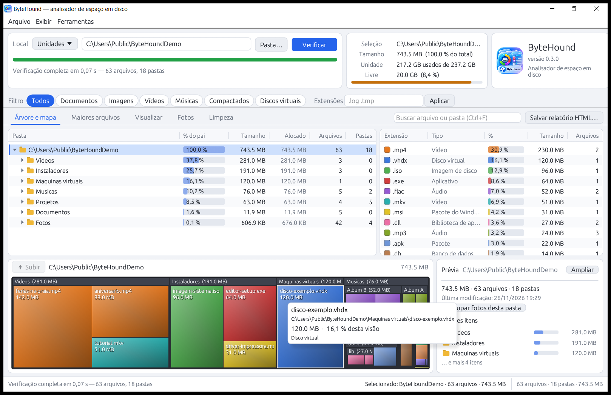

# ByteHound

Analisador de espaço em disco para Windows. **Software gratuito (freeware).** Veja a [licença](LICENSE.md).



📘 **[Manual completo, com as telas](MANUAL-ByteHound.md)**


## Existem duas versões -

Windows e Linux

Os prints abaixo foram realizados no Windows na versão inicial

## Como começar


Requer Windows de 64 bits (testado no Windows 10). Não há instalador.


1. Extraia `ByteHound-0.3.0-win-x64.zip`.
2. Execute `ByteHound.exe`. Como o programa não tem assinatura digital, o Windows pode exibir um aviso.
3. Escolha uma unidade ou pasta e clique em **Verificar**.

## Uso rápido

| Para | Faça |
|---|---|
| Achar um arquivo ou pasta | **Ctrl+F** e digite |
| Ver o que ocupa mais espaço | Aba **Árvore e mapa** ou **Maiores arquivos** |
| Abrir, mover ou excluir | Botão direito no item. Prefira **Enviar para a Lixeira** |
| Organizar fotos por local, data ou aparelho | Aba **Fotos** |
| Procurar arquivos descartáveis | Aba **Limpeza**: analise, revise e só então limpe |
| Salvar o resultado | **Salvar relatório HTML…** |
| Tema escuro | **Exibir → Tema escuro** |

## Comandos

Execute na pasta do programa.

| Comando | O que faz |
|---|---|
| `ByteHound.exe` | Abre a janela |
| `ByteHound.exe <pasta>` | Abre e analisa a pasta |
| `ByteHound.exe --relatorio [pasta] [saida.html]` | Resumo no terminal e relatório HTML |
| `ByteHound.exe --busca <pasta> <texto>` | Procura pelo nome (`--search` é igual) |
| `ByteHound.exe --limpeza` | Prévia da limpeza; não apaga nada |
| `ByteHound.exe --mcp` | Servidor MCP |
| `ByteHound.exe --ajuda` | Mostra a ajuda |

Arquivos existentes não são sobrescritos pelo relatório.

### Prompt de Comando (CMD)

```bat
start /wait "" ByteHound.exe --ajuda
```

```bat
start /wait "" ByteHound.exe --relatorio "C:\Dados" relatorio.html
```

### PowerShell

```powershell
Start-Process .\ByteHound.exe -ArgumentList '--busca "C:\Dados" contrato' -NoNewWindow -Wait
```

### Claude Code (MCP, somente leitura e relatórios)

Troque o caminho pela pasta onde está o programa:

```powershell
claude mcp add --scope user bytehound -- "C:\Programas\ByteHound\ByteHound.exe" --mcp
```

## Atenção

- A exclusão permanente não passa pela Lixeira. Em `--limpeza`, a opção `--executar` apaga sem pedir confirmação. Veja a [limpeza pela linha de comando](MANUAL-ByteHound.md#14-linha-de-comando).
- Relatórios mostram nomes e caminhos do seu computador. Revise antes de compartilhar.
- Pelo MCP, os dados consultados vão para o assistente. Veja [Privacidade](MANUAL-ByteHound.md#16-privacidade).
- O programa é fornecido sem garantia. Mantenha cópias de segurança. Veja [Distribuição e garantia](MANUAL-ByteHound.md#18-distribuição-garantia-e-créditos).
